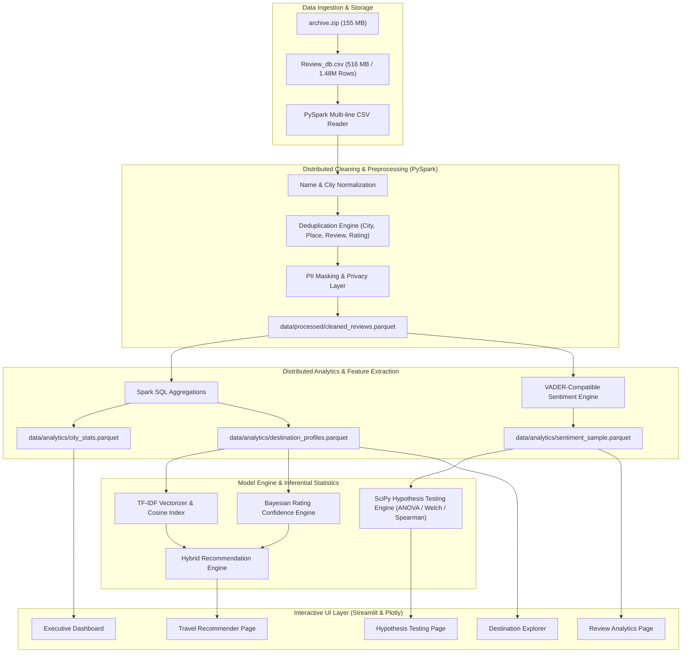

# BharatExplore: Big Data Architecture & System Pipeline

**Course:** Big Data Analysis Lab (CSL702) — Mumbai University  
**Project:** BharatExplore — Big Data-Powered Indian Travel Recommendation System  

---

## 1. High-Level Architecture Diagram

---

## 2. Component Responsibilities

| Component | Technology | Primary Function |
| :--- | :--- | :--- |
| **Ingestion Engine** | `src/ingest.py` (PySpark) | Extracts `Review_db.csv` from archive, applies explicit StructType schema, and streams raw CSV. |
| **Preprocessing & Privacy** | `src/preprocessing.py` (PySpark) | Trims names, validates rating boundaries [1.0, 5.0], deduplicates review tuples, anonymizes reviewer PII, and outputs Snappy-compressed Parquet. |
| **Analytics & Profiling** | `src/exploratory_analysis.py` (Spark SQL) | Computes global rating distributions, city volumes, and Bayesian confidence scores using distributed PySpark functions. |
| **Sentiment Engine** | `src/sentiment_analysis.py` (Python / NLTK) | Computes continuous compound valence [-1.0, 1.0], handles negations and booster tokens, and aggregates destination-level sentiment profiles. |
| **Recommendation Engine** | `src/recommendation_engine.py` (scikit-learn) | Fits TF-IDF on destination review corpora, calculates cosine similarity against traveler personas, and combines Bayesian ratings, volume bonuses, and sentiment into explainable match scores. |
| **Hypothesis Testing Engine** | `src/hypothesis_testing.py` (SciPy) | Executes One-Way ANOVA, Kruskal-Wallis, Spearman correlation, and Welch's t-test with effect sizes ($\eta^2$, Cohen's $d$). |
| **Data Access Layer** | `src/data_access.py` | High-speed, cached loader reading derived Parquet and JSON files to ensure sub-second UI interactions without re-triggering Spark jobs. |
| **Dashboard** | `app.py` & `pages/*.py` (Streamlit + Plotly) | Multi-page, interactive, responsive dashboard with custom themes, filtering widgets, and explainable AI cards. |

---

## 3. Data Flow and Storage Format

1. **Raw Storage:** `data/raw/archive.zip` and uncompressed `data/raw/Review_db.csv`.
2. **Intermediate Processed Storage:** `data/processed/cleaned_reviews.parquet` (partitioned, compressed columnar data).
3. **Analytics Marts:**
   - `data/analytics/destination_profiles.parquet`
   - `data/analytics/city_stats.parquet`
   - `data/analytics/sentiment_sample.parquet`
4. **Machine-Readable Reports:**
   - `reports/data_quality_report.json`
   - `reports/analysis_summary.json`
   - `reports/model_evaluation.json`
   - `reports/hypothesis_testing_report.json`
